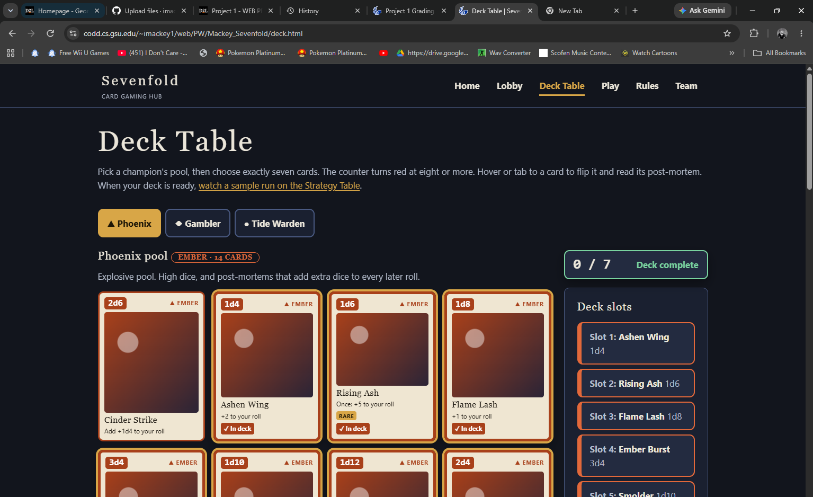

# Kanban Board Evidence

Columns: Backlog, To Do, In Progress, Review, Done. Work-in-progress limit: 2 cards (solo project, one person on the board).

Honest note on how this board was made: I did not keep a board during the first week. I rebuilt it on 2026-10-19 from my journal, QA notes and the build log, then used it to finish the last day. Dates before 2026-10-18 are approximate. Dates from 2026-10-18 on come from the journal and QA notes.

A PDF copy of this file is saved beside it as `KANBAN_BOARD.pdf`.

## One card to walk through in the video (Q9)

| Field | Entry |
| --- | --- |
| Card | Deck counter updates live as cards are added and removed |
| Created in Backlog | 2026-10-18 (part of the Deck page build) |
| Moved to To Do / In Progress | In Progress 2026-10-19 |
| Blocker, if any, and how you handled it | The counter was stuck at "0 / 7" however many cards were ticked. Cause: a stray `counter-reset` on the counter element reset the count before it was shown. I removed that line, kept `counter-increment` on the checked boxes, and `counter(picked)` in `::after`. Logged as defect 7 in `QA_NOTES.md`. |
| Moved to Review / Done | Review 2026-10-19 (tested 0 to 9 cards and back to 0 at 360px and 1280px), Done 2026-10-19 |

## Board snapshot (end of 2026-10-19)

| Backlog | To Do | In Progress (limit 2) | Review | Done |
| --- | --- | --- | --- | --- |
| Test in real Firefox and Safari | Upload to CODD and check live pages | Record walkthrough video | | All other cards below |
| W3C validators and screen-reader pass | Push to GitHub with commits | Fill links.txt | | |
| Refactor deck builder: `input:checked + label` instead of position pairing (Q12.5 plan) | | | | |
| Fourth champion (one new theme class) | | | | |
| More rounds per run (each round triples the pages) | | | | |
| Shared header and footer instead of copied markup | | | | |

## Cards for this project

| Card | Phase | Created | Started | Done | Notes |
| --- | --- | --- | --- | --- | --- |
| Pick track, extension and bonus | Plan | 2026-10-12 | 2026-10-12 | 2026-10-12 | Track D, Strategy Table Pack, bonus 6 |
| Test what HTML and CSS can do versus JavaScript | Research | 2026-10-12 | 2026-10-12 | 2026-10-17 | First week of exploring CSS-only state, `:checked`, `:target`, animation, and a JavaScript prototype to compare; decided the graded site stays CSS-only |
| Write the 42-card list and rules | Plan | 2026-10-13 | 2026-10-14 | 2026-10-16 | Three pools of 14, post-mortem effects |
| Build the card component and flip | Build | 2026-10-14 | 2026-10-15 | 2026-10-17 | Card art in CSS gradients, 3D flip on hover and focus |
| Proposal and 8 wireframes | Plan | 2026-10-15 | 2026-10-16 | 2026-10-17 | Still shows the original battler design |
| Page skeletons, header, mobile menu, footer | Build | 2026-10-17 | 2026-10-18 | 2026-10-18 | Pure CSS menu with a hidden checkbox |
| Design tokens and stylesheets (base to animations) | Build | 2026-10-17 | 2026-10-18 | 2026-10-18 | Seven stylesheets, fixed link order |
| Deck page: 42-card library and pool tabs | Build | 2026-10-18 | 2026-10-18 | 2026-10-18 | Radio tabs with `:has()` |
| **Deck counter updates live as cards are added and removed** | Build | 2026-10-18 | 2026-10-19 | 2026-10-19 | Q9 card. Fixed the stuck "0 / 7" |
| Strategy Table and dice animation | Build | 2026-10-18 | 2026-10-18 | 2026-10-18 | `@property` count-up, graveyard timing |
| Model comparison cards (bonus 6) | Build | 2026-10-18 | 2026-10-18 | 2026-10-18 | Fixed sample numbers, labelled as such |
| QA pass and first six defect fixes | QA | 2026-10-18 | 2026-10-18 | 2026-10-18 | Rules overflow, upside-down dice, contrast, and others |
| Scope change: battler to score runs | Build | 2026-10-19 | 2026-10-19 | 2026-10-19 | Removed opponent effects, kept post-mortems, 4 rounds |
| Play pages (3 champions, 121 views each) | Build | 2026-10-19 | 2026-10-19 | 2026-10-19 | Pre-computed runs linked with `:target` |
| Lobby overflow fix at 360px and QA of all views | QA | 2026-10-19 | 2026-10-19 | 2026-10-19 | Logged in QA notes |
| README, journal, QA notes | Docs | 2026-10-18 | 2026-10-18 | 2026-10-19 | Includes AI disclosure |
| Walkthrough script | Presentation | 2026-10-18 | 2026-10-18 | 2026-10-19 | Rewritten after the scope change |
| Upload to CODD and GitHub | Delivery | 2026-10-19 | | | To Do |
| Record walkthrough video | Presentation | 2026-10-19 | 2026-10-19 | | In Progress |

## Screenshot

The deck counter card (Q9): the live Deck page showing the counter stuck at "0 / 7" with seven cards in the deck, before the fix.

